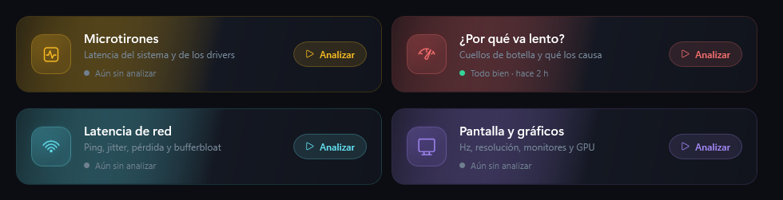
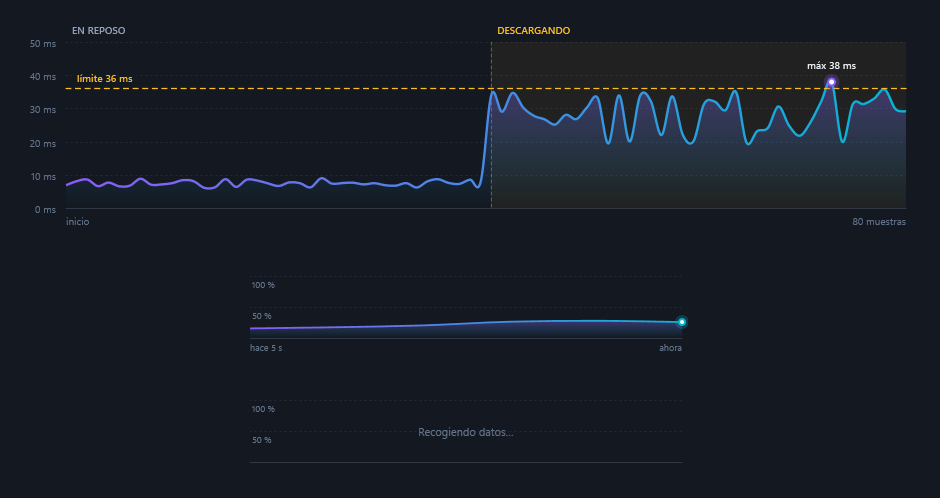
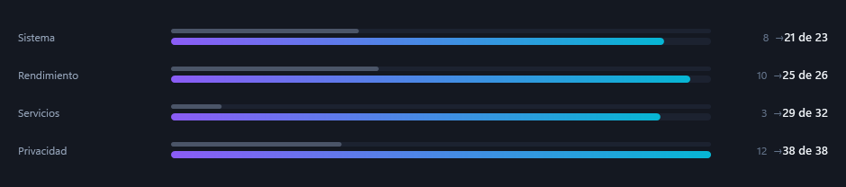

<p align="center">
  
</p>

<h1 align="center">WinRaptor Optimizer</h1>

<p align="center">
  <b>Optimizador de Windows que explica lo que hace, guarda cómo estaba todo y lo deshace con un clic.</b>
</p>

<p align="center">
  
  
  
  
  
</p>

---

> [!WARNING]
> **WinRaptor está en fase beta.** Funciona y se usa a diario, pero todavía se está probando en equipos distintos al de desarrollo.
> Puede haber fallos, textos sin pulir o funciones que cambien entre versiones.
> Todos los ajustes guardan su valor original y se pueden deshacer, y antes de aplicar cambios crea un punto de restauración,
> pero **úsalo bajo tu responsabilidad** y lee la vista previa antes de aplicar nada.

## Descargar

Descarga **`WinRaptor.exe`** de la [última versión](https://github.com/NobodyNot543/WinRaptor/releases/latest).
Es un único archivo que funciona en cualquier Windows 10/11 x64 sin instalar nada más.
Antes de abrirlo en Windows 11, lee [cómo desactivar Control inteligente de aplicaciones](#antes-de-abrirlo-desactivar-control-inteligente-de-aplicaciones).

## Índice

- [Descargar](#descargar)
- [Qué es](#qué-es)
- [Qué significa que sea beta](#qué-significa-que-sea-beta)
- [Funciones](#funciones)
- [Seguridad: cómo protege tu equipo](#seguridad-cómo-protege-tu-equipo)
- [Requisitos](#requisitos)
- [Antes de abrirlo: desactivar Control inteligente de aplicaciones](#antes-de-abrirlo-desactivar-control-inteligente-de-aplicaciones)
- [Actualizaciones](#actualizaciones)
- [Compilar y ejecutar](#compilar-y-ejecutar)
- [Publicar una versión nueva](#publicar-una-versión-nueva)
- [Estructura del proyecto](#estructura-del-proyecto)
- [Añadir un ajuste](#añadir-un-ajuste)
- [Dónde guarda sus datos](#dónde-guarda-sus-datos)
- [Hoja de ruta](#hoja-de-ruta)
- [Aviso legal](#aviso-legal)

## Qué es

**WinRaptor** es una app de escritorio para Windows que deja el equipo más rápido, más privado y listo para jugar.
A diferencia de otros optimizadores:

- **Te enseña qué va a cambiar** antes de tocar nada (registro, servicios, plan de energía…), con el valor actual y el nuevo.
- **Guarda el valor original** de todo lo que modifica, para que *Deshacer* lo deje exactamente como estaba.
- **Mide y explica**: analiza la red, el DNS, los microtirones, la lentitud, las pantallas y los drivers, y te dice qué hacer en lenguaje claro.
- **No hace nada por su cuenta**: ningún análisis ni cambio empieza hasta que pulsas el botón.

<p align="center">
  
</p>

## Qué significa que sea beta

| | |
|---|---|
| ✅ **Estable** | Aplicar y deshacer ajustes, historial de cambios, perfiles, análisis, drivers, modo juego. |
| 🧪 **En pruebas** | Comportamiento en otros equipos (otras gráficas, portátiles, sobremesa), en Windows en otros idiomas y en Windows 10. |
| ⚠️ **Limitaciones conocidas** | El ejecutable **no está firmado**: SmartScreen avisará y *Control inteligente de aplicaciones* lo bloquea ([cómo desactivarlo](#antes-de-abrirlo-desactivar-control-inteligente-de-aplicaciones)). La interfaz solo está en **español**. No hay versión para **ARM**. Necesita **permisos de administrador**. |
| 🔁 **Puede cambiar** | Nombres de secciones, diseño y algunos textos entre versiones. Los datos guardados (historial, copias de seguridad) se conservan. |

Si encuentras un fallo, la sección **Actividad** de la app y el archivo `winpulse.log` (ver [Dónde guarda sus datos](#dónde-guarda-sus-datos)) cuentan qué pasó.

## Funciones

### Optimización
| Sección | Qué hace |
|---|---|
| **182 ajustes** en 10 secciones | Sistema, Rendimiento, **Gráficos**, CPU y energía, Red y latencia, Servicios, Privacidad, Personalización, Seguridad y Reparación. |
| **Perfiles** | Básico, Medio y Avanzado, y perfiles propios guardados con nombre. Detecta qué perfil tienes aplicado. |
| **Vista previa** | Antes de aplicar, lista cada cambio con el valor actual y el nuevo, avisa de lo que puede dejar de funcionar y permite quitar elementos. |
| **Historial de cambios** | Cada cambio crea un punto. *Volver aquí* deja el equipo como estaba en ese momento; *Deshacer último* retrocede paso a paso. |
| **Aviso de reinicio** | Distingue los cambios del núcleo de Windows, de servicios y de sistema, y avisa cuando hace falta reiniciar. |

### Análisis (dentro de cada sección)
| Dónde | Análisis |
|---|---|
| **Red y latencia** | Latencia de red (ping, jitter, pérdida, *bufferbloat*) y DNS más rápido, con cambio de DNS en un clic y restauración. |
| **Rendimiento** | Microtirones (latencia del sistema y de los drivers, estilo LatencyMon) y *¿Por qué va lento?* (cuellos de botella y qué los causa). |
| **Gráficos** | Pantalla y gráficos: monitores, resolución nativa, Hz actuales y máximos (sube a la frecuencia máxima con reversión automática a los 15 s), HDR, varios monitores, gráfica integrada o dedicada y driver. |

<p align="center">
  
</p>

### Mantenimiento y diagnóstico
- **Consejos**: nota de salud del PC, recomendaciones priorizadas a partir de los diagnósticos y análisis, y hábitos de mantenimiento.
- **Diagnóstico**: disco, memoria, apagados inesperados, drivers antiguos y seguridad.
- **Drivers**: inventario, dispositivos con errores y **drivers oficiales de Windows Update** instalados en un clic, con protección contra drivers más viejos que los tuyos.
- **Quitar apps de Microsoft**: lista revisada de apps prescindibles; la Microsoft Store, winget, la seguridad y los componentes del sistema están protegidos. Se pueden reinstalar.
- **Programas de inicio**, **Actualizar programas** (winget), **Herramientas** (limpieza, SFC, DISM, red…) y **Antes y después** (comparativa con mediciones).

### Modo juego
- **Tu biblioteca**: juegos de **Steam**, **Epic Games** y **Microsoft Store / Xbox** detectados automáticamente, con portadas, y juegos añadidos a mano.
- **Un clic para jugar**: cierra apps en segundo plano, pausa tareas de fondo, pone el plan de energía al máximo, libera memoria en caché, silencia notificaciones y activa un temporizador de alta precisión.
- **Todo vuelve a como estaba** al terminar, incluso si WinRaptor se cierra a mitad de partida. Nunca cierra juegos, lanzadores, Discord ni programas de drivers.

<p align="center">
  
</p>

## Seguridad: cómo protege tu equipo

- **Copia del valor original** de cada clave del registro, servicio y ajuste de energía antes de cambiarlo.
- **Punto de restauración** automático antes de aplicar (si no hay uno de las últimas 24 h).
- **Vista previa obligatoria** de los cambios y aviso de lo que puede dejar de funcionar.
- **Listas cerradas**: solo se pueden quitar apps de un catálogo revisado y solo se cierran procesos conocidos en el modo juego.
- **Cambios de pantalla reversibles**: si no confirmas la nueva frecuencia en 15 s, vuelve sola a la anterior.
- **Sin telemetría**: WinRaptor no envía datos a ningún servidor. Solo se conecta para medir la red, consultar Windows Update, descargar portadas de juegos que no estén en tu PC y buscar versiones nuevas de WinRaptor en GitHub.

## Requisitos

| | |
|---|---|
| Sistema | Windows 10 u 11 de 64 bits (x64) |
| Permisos | Administrador (lo pide al abrirse) |
| Runtime | [.NET 9 Desktop Runtime](https://dotnet.microsoft.com/download/dotnet/9.0), salvo en la versión autocontenida |
| Para compilar | [.NET 9 SDK](https://dotnet.microsoft.com/download/dotnet/9.0) |

## Antes de abrirlo: desactivar Control inteligente de aplicaciones

> [!IMPORTANT]
> **Es necesario desactivar el *Control inteligente de aplicaciones* (Smart App Control) de Windows 11 para poder usar WinRaptor.**
> Como el ejecutable todavía **no tiene firma digital**, esta protección lo bloquea sin dar opción a abrirlo
> (aparece un aviso de que *«Control inteligente de aplicaciones bloqueó una aplicación que puede no ser segura»*).
> Windows 10 no tiene esta función, así que ahí no hace falta hacer nada.

### Cómo desactivarlo

1. Abre **Inicio**, escribe **Seguridad de Windows** y ábrela.
2. Entra en **Control de aplicaciones y navegador**.
3. Pulsa **Configuración de Control inteligente de aplicaciones**.
4. Elige **Desactivado** y confirma en la ventana de Control de cuentas de usuario.
5. Vuelve a abrir `WinRaptor.exe`.

> [!WARNING]
> En muchas versiones de Windows 11, **una vez desactivado ya no se puede volver a activar sin reinstalar o restablecer Windows**.
> En las versiones más recientes Microsoft permite reactivarlo desde la misma pantalla. Tenlo en cuenta antes de desactivarlo.
> Tu equipo sigue protegido por el antivirus de Microsoft Defender y por SmartScreen.

### Si aparece SmartScreen («Windows protegió tu PC»)

Es un aviso distinto y no bloquea del todo: pulsa **Más información** y después **Ejecutar de todas formas**.

Si descargaste el programa en un `.zip`, también puedes evitar avisos haciendo clic derecho en el archivo descargado →
**Propiedades** → marcar **Desbloquear** → **Aceptar**, antes de descomprimirlo.

## Actualizaciones

WinRaptor se actualiza desde la propia app, **sin volver a descargarlo y sin perder tu configuración**:

1. Al abrirse, comprueba si hay una versión nueva en las [Releases](https://github.com/NobodyNot543/WinRaptor/releases).
   También puedes comprobarlo cuando quieras pulsando el número de versión, debajo de tu nombre en el menú.
2. Si la hay, aparece el botón **Actualizar a vX.Y.Z**. Al pulsarlo muestra las novedades y pide confirmación.
3. Descarga el nuevo `WinRaptor.exe`, comprueba que esté completo (tamaño y huella SHA-256), lo pone en lugar del actual y se vuelve a abrir.

Solo se sustituye el ejecutable. Tus ajustes aplicados, el historial, los perfiles y las preferencias están en
`%LOCALAPPDATA%\WinPulse` (ver [Dónde guarda sus datos](#dónde-guarda-sus-datos)) y no se tocan.
Si algo falla durante la actualización, la versión que tenías queda intacta.
Mientras el modo juego está activo no se puede actualizar, para que el equipo quede antes como estaba.

> [!NOTE]
> La actualización automática está disponible a partir de la versión 2.6.0. Si tienes una anterior, descarga la 2.6.0 una vez a mano.

## Compilar y ejecutar

```powershell
# Compilar (sale en bin\Release\net9.0-windows\WinRaptor.exe)
dotnet build -c Release

# Publicar dependiente del runtime (carpeta pequeña; necesita .NET 9 Desktop Runtime)
dotnet publish WinPulse.csproj -c Release -o publish -p:SelfContained=false

# Publicar autocontenido (funciona en cualquier Windows x64 sin instalar nada; ~150 MB)
dotnet publish WinPulse.csproj -c Release -r win-x64 --self-contained true -o publish-portable
```

> [!NOTE]
> En equipos con **Control inteligente de aplicaciones** activado, el ejecutable compilado se bloqueará porque no tiene firma digital.
> Desactívalo como se explica en [Antes de abrirlo](#antes-de-abrirlo-desactivar-control-inteligente-de-aplicaciones).
> La solución definitiva es firmar el ejecutable con un certificado de firma de código.

## Publicar una versión nueva

Las versiones se compilan y publican solas con GitHub Actions (`.github/workflows/release.yml`):

1. En GitHub, entra en **Actions** → **Publicar versión** → **Run workflow**.
2. Escribe la versión (por ejemplo `2.6.1`; tiene que ser mayor que la anterior), y si quieres las novedades.
3. Pulsa **Run workflow**. En unos minutos aparece la Release con `WinRaptor.exe` adjunto.

También se puede publicar subiendo una etiqueta:

```powershell
git tag v2.6.1
git push origin v2.6.1
```

Las apps instaladas verán la versión nueva la próxima vez que se abran.
Si subes una Release a mano, el archivo adjunto debe llamarse exactamente **`WinRaptor.exe`** y la etiqueta debe tener el formato `v2.6.1`.

## Estructura del proyecto

| Archivo | Contenido |
|---|---|
| `MainWindow.xaml` / `.cs` | Interfaz completa y lógica de cada sección. |
| `App.xaml` | Paleta de colores y estilos (botones, interruptores, tarjetas, menú). |
| `Engine.cs` | Motor de ajustes: aplica, guarda copias y deshace. También ejecuta comandos y registra la actividad. |
| `tweaks.json` | Catálogo de los 182 ajustes (se incrusta en el ejecutable). |
| `Analysis.cs` | Latencia de red, DNS, microtirones y lentitud. |
| `Display.cs` | Monitores, frecuencias, HDR y gráfica. |
| `Drivers.cs` | Inventario de drivers e instalación desde Windows Update. |
| `GameMode.cs` / `GameLibrary.cs` | Modo juego y biblioteca de Steam, Epic y Microsoft Store. |
| `Advisor.cs` | Consejos y nota de salud del PC. |
| `Apps.cs` | Catálogo de apps que se pueden quitar y lista de protegidas. |
| `Preview.cs` | Vista previa de cambios con valores actuales. |
| `Updater.cs` | Busca versiones nuevas en GitHub y actualiza el ejecutable sin tocar los datos. |
| `Features.cs`, `SystemTools.cs`, `BeforeAfter.cs`, `Settings.cs`, `UserInfo.cs` | Diagnóstico, herramientas, mediciones, preferencias y datos del usuario. |
| `Charts.cs` / `Motion.cs` | Gráficas propias y animaciones. |
| `WinRaptor.ico`, `logo.png`, `mark.png`, `mark-bold.png` | Icono y logotipos. |

> El archivo de proyecto se llama `WinPulse.csproj` y el espacio de nombres `WinPulse` por el nombre original del proyecto;
> el ejecutable que genera es `WinRaptor.exe`.

## Añadir un ajuste

Cada ajuste es un objeto en `tweaks.json`:

```json
{ "id": "mi_ajuste", "sec": "sistema", "profile": "basic",
  "title": "Título", "desc": "Qué hace", "breaks": [], "restart": "",
  "apply": [ { "k": "reg", "hive": "HKCU", "path": "Software\\...", "name": "Valor", "type": "DWORD", "value": 1 } ],
  "revert": [] }
```

| `k` | Qué hace | Copia automática |
|---|---|---|
| `reg` | Escribe un valor del registro (`type`: DWORD, QWORD, SZ, EXPAND_SZ) | Sí |
| `regdel` | Borra un valor del registro | Sí |
| `iface` | Escribe un valor en cada adaptador de red con IP | Sí |
| `svc` | Cambia el modo de inicio de un servicio (`mode`: auto, delayed-auto, demand, disabled) | Sí |
| `power` | Cambia un ajuste del plan de energía con el equipo enchufado (`sub`, `setting`, `value`) | Sí |
| `dx` | Cambia una opción de `DirectXUserGlobalSettings` sin tocar las demás | Sí |
| `run` | Ejecuta un comando | No: añade su inverso en `revert` |

- **`sec`**: sistema, rendimiento, graficos, cpu, red, servicios, privacidad, personalizacion, seguridad, reparacion.
- **`profile`**: basic, medium, high.
- **`restart`**: `""`, `session` (reiniciar el Explorador) o `reboot`.
- **Estado en vivo**: si un ajuste solo usa operaciones con copia automática, su estado se lee del sistema; si tiene algún `run`, se lee del archivo de estado.

## Dónde guarda sus datos

Todo queda en `%LOCALAPPDATA%\WinPulse` (la carpeta conserva el nombre original para no perder datos entre versiones):

| Archivo | Para qué |
|---|---|
| `state.json` | Ajustes aplicados y su valor original (lo que permite deshacer). |
| `history.json` | Puntos del historial de cambios. |
| `profiles.json` | Perfiles propios. |
| `insights.json` | Últimos resultados de diagnósticos y análisis (para Consejos). |
| `snapshots.json` | Mediciones para *Antes y después*. |
| `settings.json` | Perfil elegido y reinicio pendiente. |
| `gamemode.json` | Sesión de modo juego en curso (para restaurarla si la app se cierra). |
| `games.json`, `removed_apps.json`, `dns_backup.json` | Juegos añadidos, apps quitadas y DNS original. |
| `winpulse.log` | Registro de actividad. |

> [!CAUTION]
> No copies esta carpeta a otro PC: las copias de los valores originales son de **este** equipo.

## Hoja de ruta

- [ ] Firma digital del ejecutable (sin avisos de SmartScreen ni bloqueos).
- [x] Versión autocontenida de un solo archivo en las Releases.
- [ ] Interfaz en inglés.
- [ ] Pruebas en más configuraciones (NVIDIA, Intel, sobremesa, Windows 10).
- [x] Actualización desde la propia app sin perder la configuración.
- [ ] Detección de juegos de Battle.net, EA App, Ubisoft Connect y GOG.

## Aviso legal

WinRaptor modifica la configuración de Windows. Aunque guarda los valores originales y permite deshacer todos los cambios,
**se ofrece tal cual, sin garantías**, y su uso es responsabilidad de quien lo ejecuta.
WinRaptor no está afiliado a Microsoft, Valve, Epic Games, AMD, NVIDIA ni Intel; sus nombres y marcas pertenecen a sus dueños.

<p align="center">
  
  <br>
  <sub>WinRaptor Optimizer · versión beta</sub>
</p>
